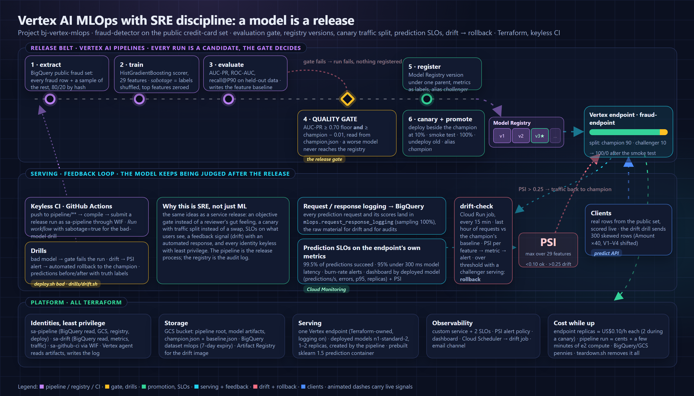

# Vertex AI MLOps with SRE discipline: a model is a release

[](demo/demo.mp4)

A fraud-detection model on the public ULB credit-card set, shipped the way a service is shipped. A **Vertex AI
Pipeline** extracts from BigQuery, trains, evaluates, and then a **quality gate** decides: a candidate reaches the
**Model Registry** only if its AUC-PR clears an absolute floor *and* does not regress the current champion. The
new version is **canary-deployed** next to the champion on one **Vertex endpoint** (traffic split 10/90), smoke-tested
through the endpoint, promoted to 100%, and the old version undeployed. After the release the model keeps being
judged: **prediction SLOs** on the endpoint's own metrics, every request logged to **BigQuery**, and a scheduled
**drift job** computing **PSI** per feature against the champion's training baseline, which **rolls traffic back to
the champion automatically** when a challenger drifts. Two drills prove it: a sabotaged model the gate refuses, and
skewed traffic that triggers the rollback. Terraform for everything; keyless CI submits the pipeline.

- Demo video: [`demo/demo.mp4`](demo/demo.mp4) · captions [`demo/captions.srt`](demo/captions.srt) · transcript [`demo/transcript.md`](demo/transcript.md)
- Docs site: [`docs/index.html`](docs/index.html) · pipeline: [`pipeline/pipeline.py`](pipeline/pipeline.py) · drift job: [`drift/drift_check.py`](drift/drift_check.py) · drills: [`drills/`](drills/)
- Project: `bj-vertex-mlops` · region `us-central1`
- **Rebuild from scratch, with the gotchas: [`REBUILD.md`](REBUILD.md)**

## The release belt (`pipeline/pipeline.py`)

| Step | What happens | Where it can stop |
|---|---|---|
| 1 extract | BigQuery: every fraud row + a hashed sample of the rest, split 80/20 by hash | |
| 2 train | `HistGradientBoostingRegressor` on the label as a fraud scorer (predict → score in [0,1], so the prebuilt sklearn container returns a probability-like score); `sabotage=True` shuffles a third of the labels and zeroes V14/V17/V12 | |
| 3 evaluate | AUC-PR, ROC-AUC, recall at 90% precision on the held-out split; writes the feature baseline (10 quantile bins per feature) | |
| 4 **gate** | fail unless `auc_pr >= 0.70` and `auc_pr >= champion.auc_pr - 0.01` (`gs://<bucket>/champion.json`) | **here**: a worse model never reaches the registry |
| 5 register | `Model.upload` as a new version under the `fraud-detector` parent, metrics as labels, alias `challenger` | |
| 6 canary + promote | deploy beside the champion with 10% traffic (n1-standard-2, 1–2 replicas), smoke-test the endpoint, 100%, undeploy the old version, alias `champion`, publish `champion.json` + `baseline.json` | smoke failure |

`./deploy.sh release` runs it; `./deploy.sh bad` runs it with `sabotage=True`; GitHub Actions runs it on every push to
`pipeline/**` (and on demand with `sabotage=true`).

## After the release (`drift/`, `terraform/monitoring.tf`)

- **Request/response logging**: the endpoint writes every request and its scores to `mlops.request_response_logging` (BigQuery, 100% sampling, 7-day expiry).
- **drift-check** (Cloud Run job, every 15 min, and `drills/drift.sh`): last hour of logged requests vs `baseline.json`, PSI per feature, custom metrics `ml/psi_max` and `ml/psi_feature`, alert above 0.25; with `AUTO_ROLLBACK=1` and a challenger serving, traffic goes back to the champion's deployed model.
- **SLOs** on `aiplatform.googleapis.com/prediction/online/*`: 99.5% of predictions succeed, 95% under 300 ms model latency, fast-burn alerts, a dashboard by deployed model plus the PSI series.

## Drills

| Drill | Command | Expect |
|---|---|---|
| Bad model | `./deploy.sh bad` | evaluate reports a collapsed AUC-PR; the gate step fails with the reason; the run is red; registry and endpoint untouched |
| Drift → rollback | `./deploy.sh release --no-promote` (challenger at 10%), then `drills/drift.sh` | 300 skewed requests; PSI max well above 0.25 on Amount/V1–V4; `ROLLED BACK` with the champion at 100%; the PSI alert fires |
| Predictions | `drills/predict.sh 5` | live scores with truth labels and the serving model version/latency |

## What is where

```
pipeline/       pipeline.py (6 components, KFP v2), submit.py (compile + run + wait), requirements.txt
drift/          drift_check.py (PSI, custom metrics, rollback), Dockerfile
drills/         predict.sh, drift.sh
terraform/      bucket, BigQuery dataset, Artifact Registry, Vertex endpoint (logging on), drift job + scheduler,
                SLOs/alerts/dashboard, service accounts (pipeline, drift, scheduler, build, CI) + WIF
.github/        release.yml: compile -> submit the release run, keyless
deploy.sh       full bring-up / release / bad / drift-image;  smoke.sh;  teardown.sh;  reimport.sh;  audit-billing.sh
docs/           index.html (GitHub Pages), architecture.html (live diagram), architecture.png
demo/           scenes.py + recorder.py, demo.mp4, captions, transcript
```

## Cost while it runs

Each deployed model keeps one n1-standard-2 replica (~US$0.10/hour; two during a canary). A pipeline run costs
cents of orchestration plus a few minutes of small VMs. BigQuery and GCS are pennies. `./teardown.sh` undeploys,
destroys and audits.
